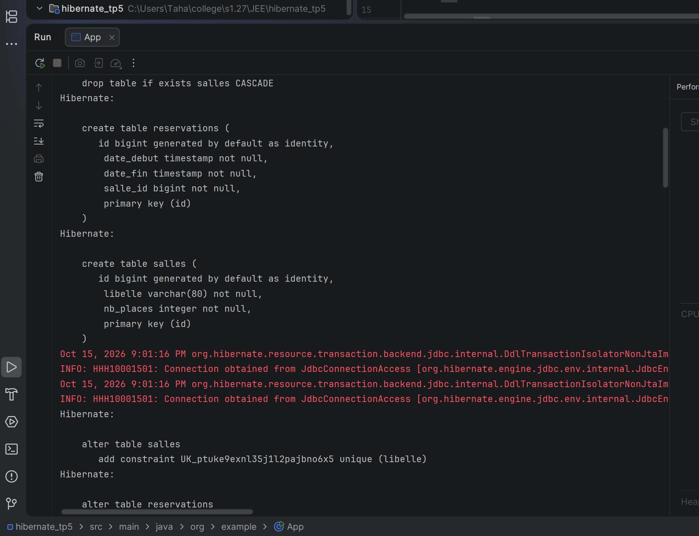
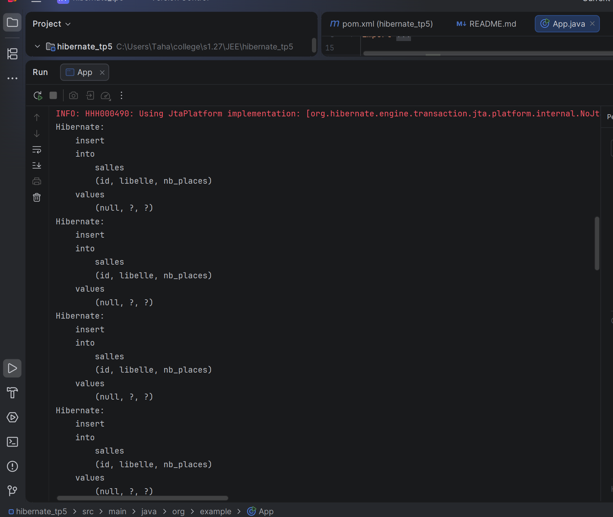
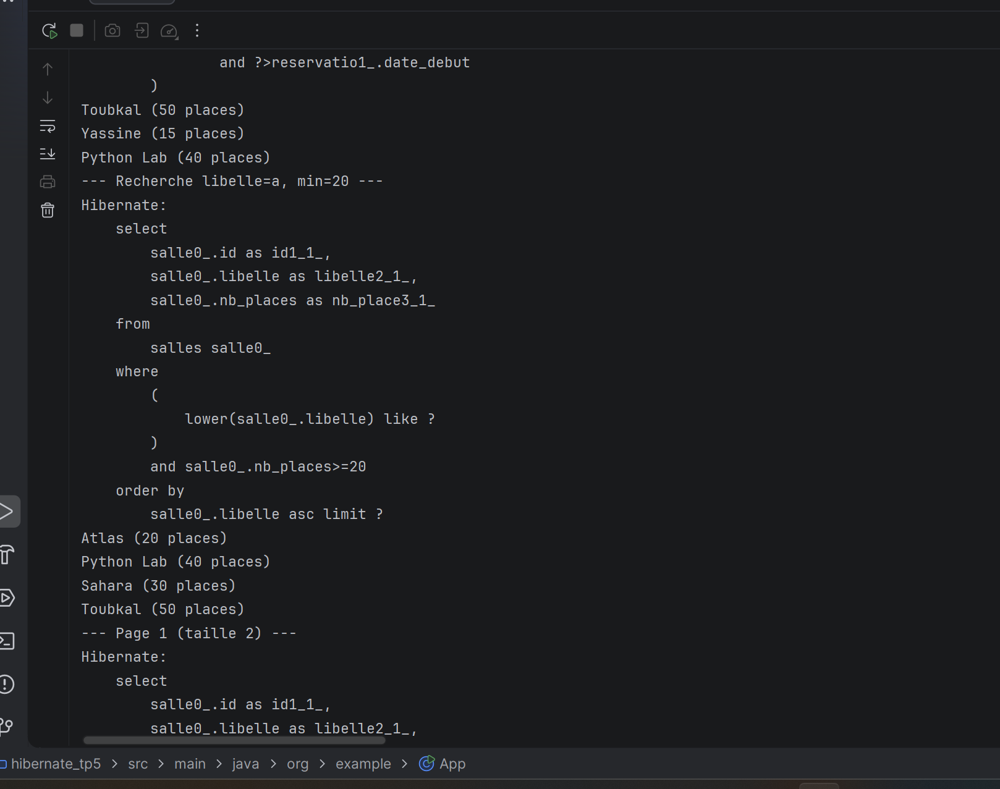
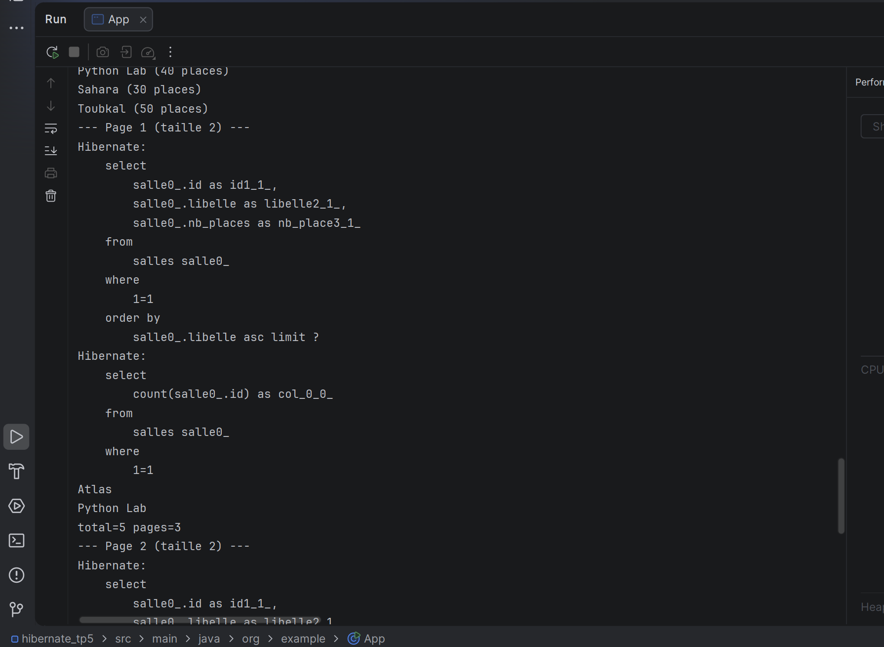
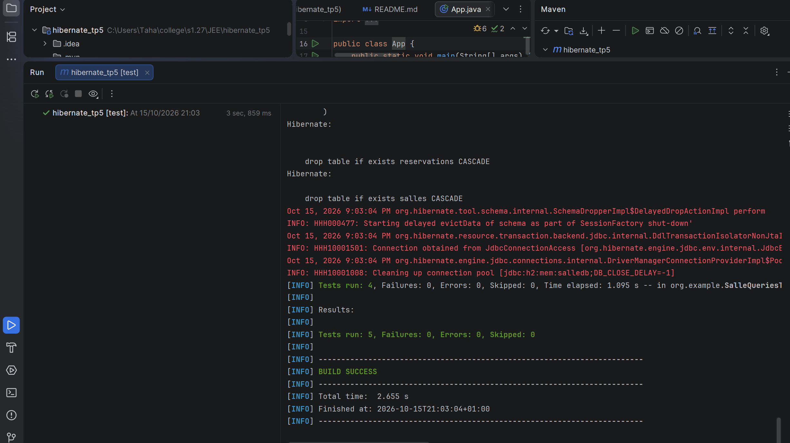

 execution de App, demarrage de la persistence SallePU sur H2 salledb et creation des tables salles et reservations :

```console
INFO: HHH000204: Processing PersistenceUnitInfo [name: SallePU]
INFO: HHH000412: Hibernate ORM core version 5.4.30.Final
INFO: HHH000400: Using dialect: org.hibernate.dialect.H2Dialect
Hibernate: drop table if exists reservations CASCADE
Hibernate: drop table if exists salles CASCADE
Hibernate: create table salles (id bigint generated by default as identity, libelle varchar(80) not null, nb_places integer not null, primary key (id))
Hibernate: create table reservations (id bigint generated by default as identity, date_debut timestamp not null, date_fin timestamp not null, salle_id bigint not null, primary key (id))
Hibernate: alter table salles add constraint unique (libelle)
Hibernate: alter table reservations add constraint foreign key (salle_id) references salles
```

Capture du demarrage et du schema genere :



Insertion des 5 salles Atlas Toubkal Sahara Yassine Python Lab et des 2 reservations qui se chevauchent, puis JPQL des salles disponibles sur le creneau 09h-11h :

```console
Hibernate: insert into salles (libelle, nb_places) values (Atlas, 20)
Hibernate: insert into salles (libelle, nb_places) values (Toubkal, 50)
Hibernate: insert into salles (libelle, nb_places) values (Sahara, 30)
Hibernate: insert into salles (libelle, nb_places) values (Yassine, 15)
Hibernate: insert into salles (libelle, nb_places) values (Python Lab, 40)
Hibernate: insert into reservations (salle_id, date_debut, date_fin) values (Atlas, 2025-06-01T09:00, 2025-06-01T11:00)
Hibernate: insert into reservations (salle_id, date_debut, date_fin) values (Sahara, 2025-06-01T10:00, 2025-06-01T12:00)
Hibernate: select s from Salle s where s.id not in (select r.salle.id from Reservation r where (:debut < r.dateFin and :fin > r.dateDebut))
--- Disponibles 2025-06-01T09:00 -> 2025-06-01T11:00 ---
Toubkal (50 places)
Yassine (15 places)
Python Lab (40 places)
```

Capture de la requete JPQL et des salles disponibles :



Recherche multi-criteres avec Criteria, filtre libelle contenant a et capacite minimale 20, Yassine est exclue car 15 places :

```console
Hibernate: select s from Salle s where lower(libelle) like %a% and nb_places >= 20 order by libelle asc
--- Recherche libelle=a, min=20 ---
Atlas (20 places)
Python Lab (40 places)
Sahara (30 places)
Toubkal (50 places)
Hibernate: select s from Salle s where lower(libelle) like %python% and nb_places >= 30
Python Lab (40 places)
```

Capture de la recherche Criteria :



Pagination cote serveur avec setFirstResult et setMaxResults, 5 salles en pages de 2 donc 3 pages, meme filtres repris pour le count :

```console
Hibernate: select s from Salle s order by libelle asc limit 2 offset 0
--- Page 1 (taille 2) ---
Atlas
Python Lab
total=5 pages=3
Hibernate: select count(s) from Salle s
Hibernate: select s from Salle s order by libelle asc limit 2 offset 2
--- Page 2 (taille 2) ---
Sahara
Toubkal
total=5 pages=3
```

Capture de la pagination :



Tests JUnit, un test par fonctionnalite avec persist requetes et asserts, les 5 tests passent :

```console
Tests run: 1, Failures: 0, Errors: 0, Skipped: 0 -- in org.example.AppTest
Tests run: 4, Failures: 0, Errors: 0, Skipped: 0 -- in org.example.SalleQueriesTest
Tests run: 5, Failures: 0, Errors: 0, Skipped: 0
BUILD SUCCESS
```

Capture des tests :


